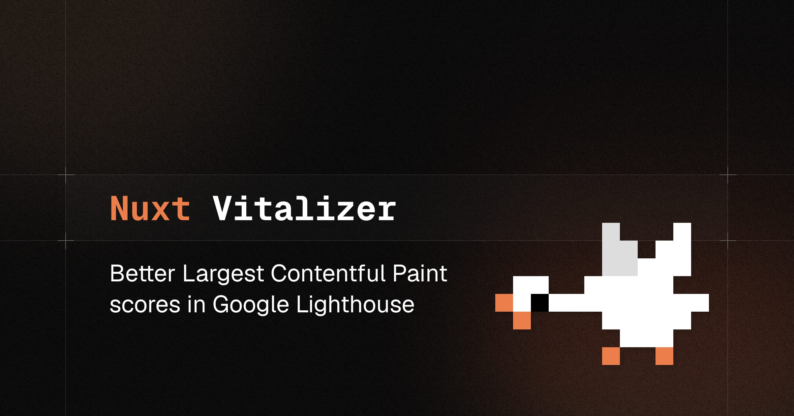

# Nuxt Vitalizer

Better Largest Contentful Paint scores for your [Nuxt](https://nuxt.com) app in [Google Lighthouse](https://developer.chrome.com/docs/lighthouse).

- [✨ &nbsp;Release Notes](https://github.com/johannschopplich/nuxt-vitalizer/releases)

> [!IMPORTANT]
> This moves the Lighthouse score, and only sometimes the field metric. Lighthouse's Lantern simulator counts every request that finishes before the observed LCP against the critical path, prefetches included, so removing them shortens the simulation. In the field those same prefetches make the next navigation faster. Measure with [CrUX](https://developer.chrome.com/docs/crux) before and after.

## Features

- 🔗 [No prefetch links for dynamic imports](#disable-prefetch-links-for-dynamic-imports), on by default
- 🪶 [Optional removal of `modulepreload` links](#disable-preload-links)
- 🧪 Build-time only, no runtime code in your bundle
- 🦾 SSR-ready

## Setup

> [!NOTE]
> Requires Nuxt 4.6 or later. The module does nothing during `nuxt dev` and `nuxt prepare` – build the app to see its effect.

Install the package and add it to the `modules` section of your Nuxt configuration in one step:

```bash
npx nuxt module add vitalizer
```

## Basic Usage

The command registers the module without options:

```ts
// `nuxt.config.ts`
export default defineNuxtConfig({
  modules: ['nuxt-vitalizer'],
})
```

That is `disablePrefetchLinks: 'dynamicImports'`, the default: every `<link rel="prefetch">` Nuxt renders for a dynamic import is gone from the next build. `disablePreloadLinks` is off until you turn it on.

## What Each Option Changes

Measured on Nuxt 4.6.4 with the fixture in `test/fixture`: three routes, one component shared between two of them, one stylesheet imported from a plain `.ts` module, one from a dynamically imported one, one lazy component that stays unmounted, one image above Vite's inline limit, and a global stylesheet registered through `nuxt.config`. The e2e suite asserts every number below.

| `vitalizer` options | `modulepreload` | `prefetch` (script) | `prefetch` (image) | `stylesheet` |
| --- | --- | --- | --- | --- |
| *(defaults)* | 4 | 0 | 1 | 2 |
| `disablePrefetchLinks: true` | 4 | 0 | 0 | 2 |
| `disablePrefetchLinks: false` | 4 | 3 | 1 | 2 |
| `disablePrefetchLinks: false`, `disablePreloadLinks: true` | 0 | 0 | 1 | 2 |

Row three is what Nuxt does on its own. Row four adds `disablePreloadLinks` to row three, and the script prefetches go with the `modulepreload` links, because Nuxt derives them from the preload set.

### Disable Prefetch Links for Dynamic Imports

Nuxt renders a `<link rel="prefetch">` for every dynamic import the current page does not mount, such as a lazy component behind a `v-if`. Each one is a request the browser starts before it knows whether the chunk is needed. The default, `disablePrefetchLinks: 'dynamicImports'`, removes these links.

Set `disablePrefetchLinks` to `true` to drop every prefetch link instead, images included:

```ts
export default defineNuxtConfig({
  modules: ['nuxt-vitalizer'],

  vitalizer: {
    disablePrefetchLinks: true,
  },
})
```

Neither setting stops the prefetching `<NuxtLink>` starts in the browser.

### Disable Preload Links

> [!WARNING]
> This is the one option here that can make your LCP worse. Without `modulepreload`, the browser only discovers a chunk's dependencies once it has parsed the chunk, so a deep import graph turns into a request waterfall. It wins on constrained connections and against "preload not used" warnings, and it loses on high latency. Measure before you ship it.

`modulepreload` links tell the browser to fetch a chunk the current page does need. In a large application that is a burst of requests before the first paint, and the chunks at the back of the queue arrive later than they would have on demand.

```ts
export default defineNuxtConfig({
  modules: ['nuxt-vitalizer'],

  vitalizer: {
    disablePreloadLinks: true,
  },
})
```

`vite.build.modulePreload: false` does not remove these links: it governs only Vite's own output, and the `<link rel="modulepreload">` tags in the server-rendered HTML come from Nuxt's client manifest.

### Why Nuxt Has No Equivalent Switch

Both options are manifest edits Nuxt deliberately does not expose. The tracking issue [nuxt#14584](https://github.com/nuxt/nuxt/issues/14584) was open from 2022 to 2026, and the position there is a design decision rather than a backlog item:

> Build-time and manifest based page prefetching is probably something we don't want to do in Nuxt 3 since [it] was always tricky in Nuxt 2 when number of pages increases. Only reliable way to predict next pages is runtime rendering.
>
> – [@pi0](https://github.com/nuxt/nuxt/issues/14584#issuecomment-1397360645)

Nuxt does prune individual bad hints as they are found, for example in [nuxt#35342](https://github.com/nuxt/nuxt/pull/35342), [nuxt#35691](https://github.com/nuxt/nuxt/pull/35691), [nuxt#35812](https://github.com/nuxt/nuxt/pull/35812) and [nuxt#36056](https://github.com/nuxt/nuxt/pull/36056). This module is the blanket switch: it strips the hints for every manifest entry instead of one case at a time.

## Module Options

| Option | Type | Default | Description |
| --- | --- | --- | --- |
| `disablePrefetchLinks` | `boolean \| 'dynamicImports'` | `'dynamicImports'` | Whether to remove prefetch links from the HTML. `'dynamicImports'` drops only the links Nuxt renders for dynamic imports; `true` drops every prefetch link, images included; `false` disables the feature. |
| `disablePreloadLinks` | `boolean` | `false` | Whether to remove `modulepreload` links from the HTML. Also drops the script prefetch links of dynamically imported chunks, since Nuxt derives those from the preload set. |

## Migrating to v4

**Nuxt 4.6 is required.** On Nuxt 4.0–4.5, Nuxt skips the module with the warning ``Module `nuxt-vitalizer` is disabled due to incompatibility issues`` and builds without it. The last release for Nuxt 4.0–4.5 is v3.0.0, and for Nuxt 3 it is v0.10.0.

**`disableStylesheets` is gone.** It worked around the duplicate stylesheet links of [nuxt#35255](https://github.com/nuxt/nuxt/issues/35255), which Nuxt 4.6 fixed. Delete the key from your `vitalizer` options – until you do, the module warns `` `disableStylesheets` has been removed ``.

## 💻 Development

1. Clone this repository
2. Enable [Corepack](https://github.com/nodejs/corepack) using `corepack enable`
3. Install dependencies using `pnpm install`
4. Run `pnpm run dev:prepare`
5. Build the playground using `pnpm run dev:build` – the module is inert in `pnpm run dev`
6. Run the tests using `pnpm run test`

## Credits

- [@mummybot](https://github.com/mummybot) for the [manifest snippet](https://github.com/nuxt/nuxt/issues/14584#issuecomment-2166544081) this module grew out of.
- All the discussions and contributions in the Nuxt GitHub issues that inspired this module.

## License

[MIT](./LICENSE) License © 2024-PRESENT [Johann Schopplich](https://github.com/johannschopplich)
